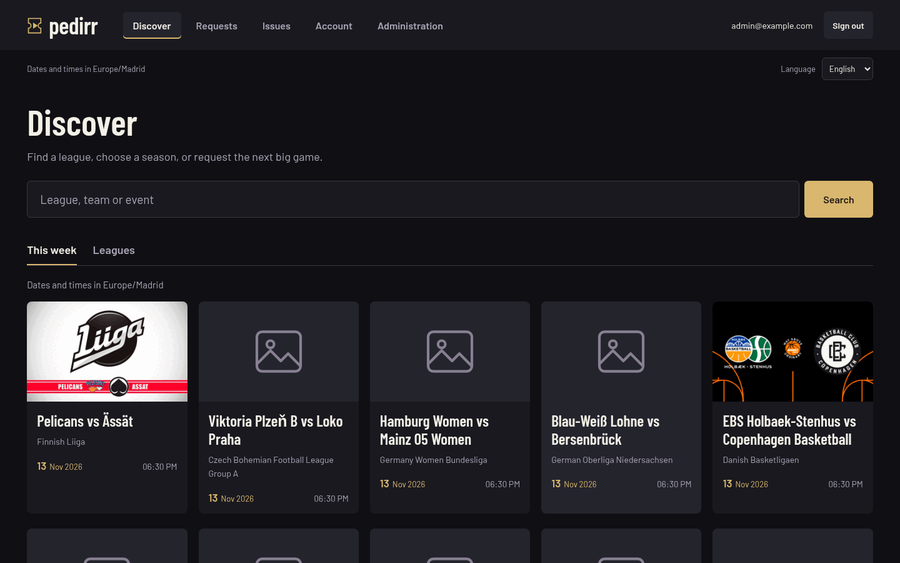
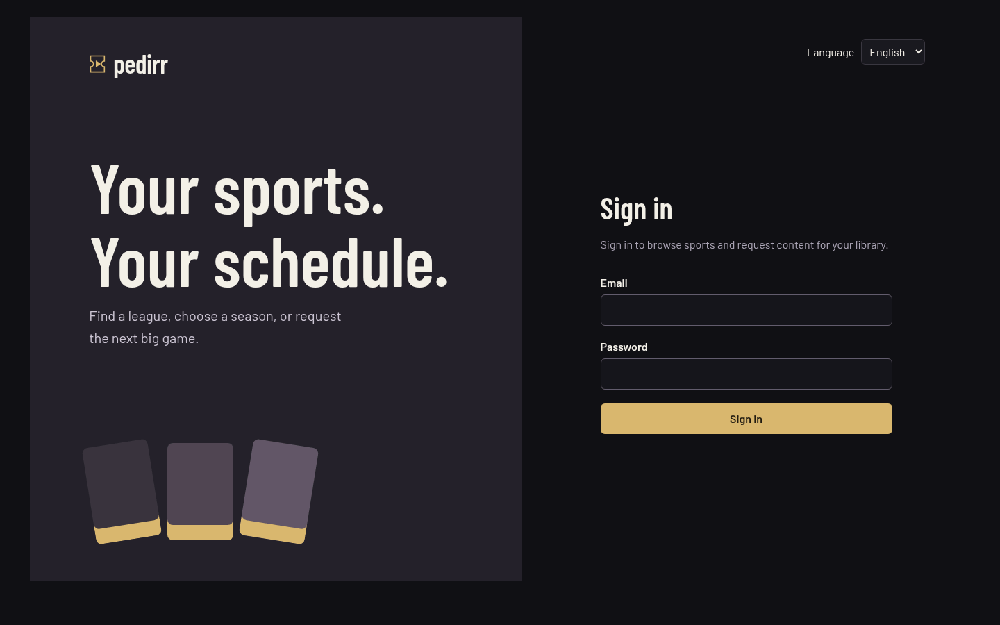
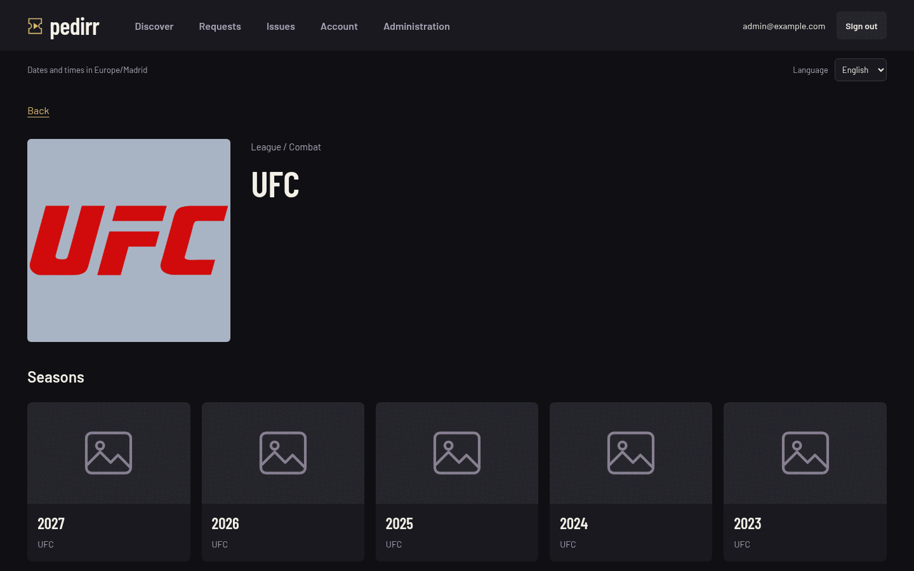
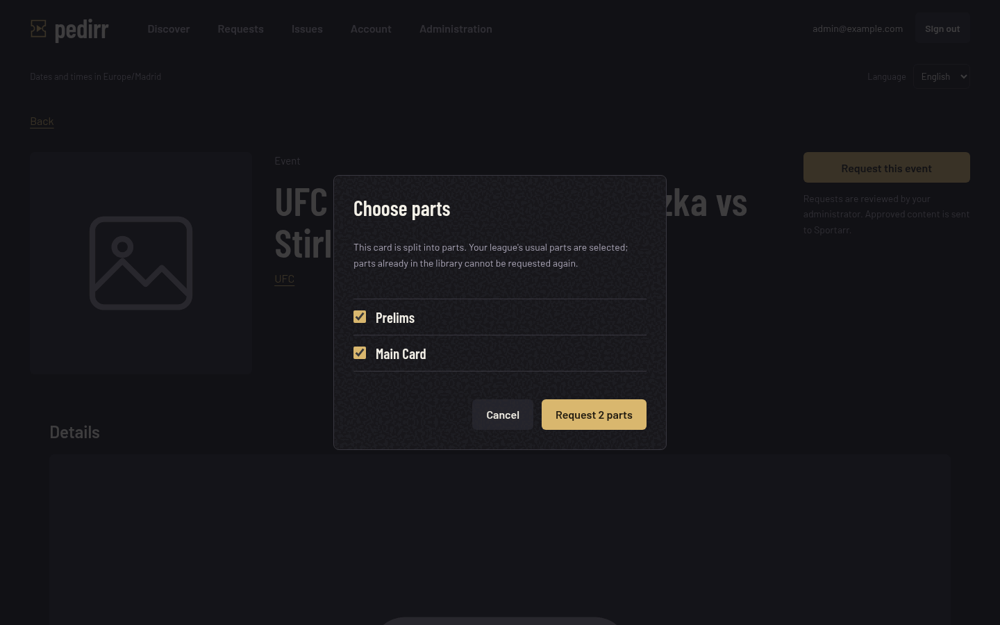
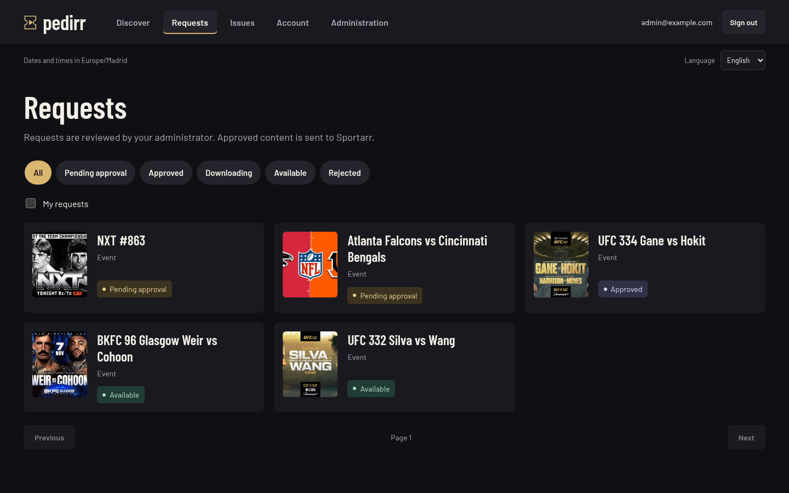
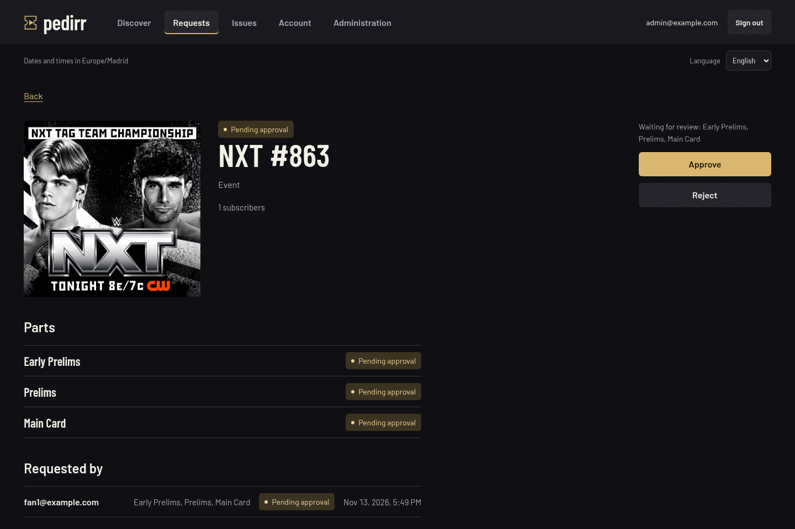
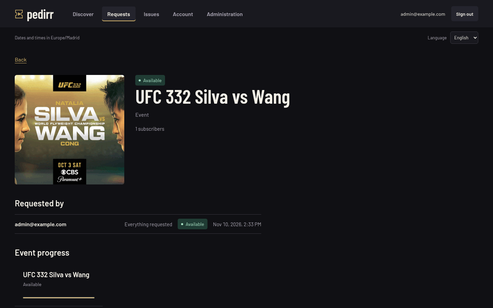
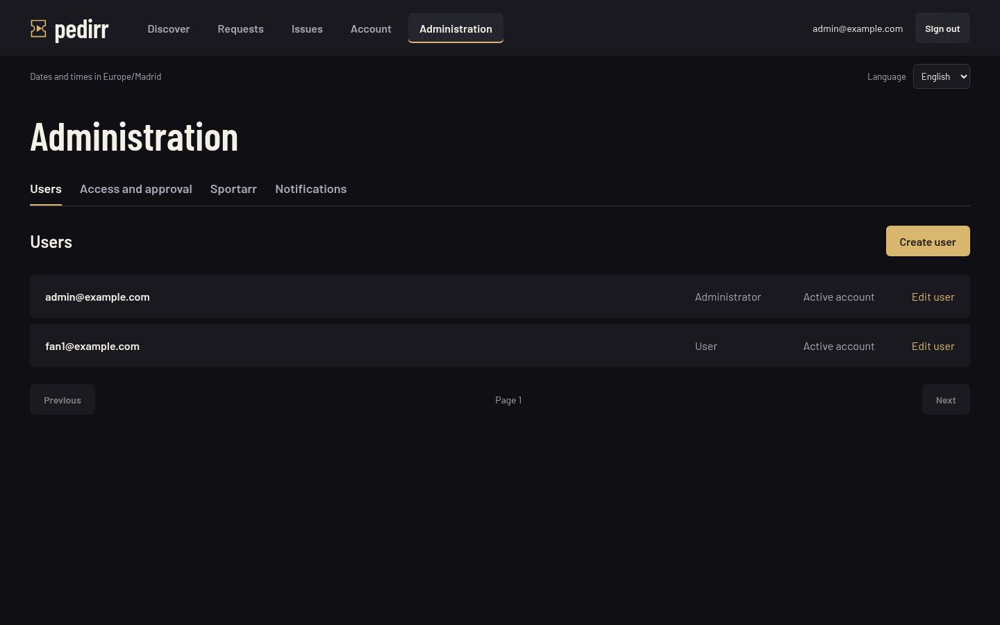
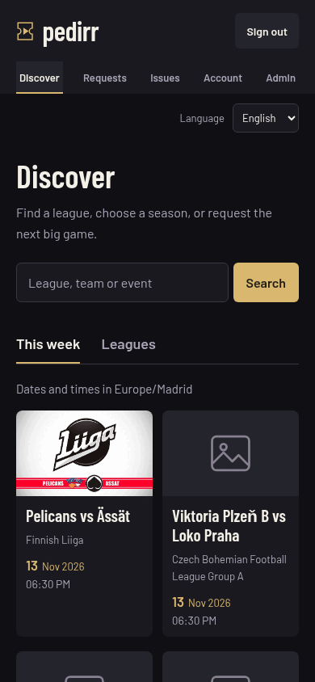

# Pedirr

Sports content requests for [Sportarr](https://sportarr.net). People browse the Sportarr Hub catalog, request a fight card, a game or a whole season, and Pedirr sends approved requests to Sportarr, follows the download and tells them when it is in the library.



## Features

- **Discovery**: search leagues, teams and events, browse seasons, and see the next seven days of events.
- **Requests**: request single events or, when an administrator allows it, whole seasons. Requests are shared, so the same content is never requested or downloaded twice.
- **Event parts**: fight cards are requested by part (Early Prelims, Prelims, Main Card…), with each person's own status.
- **Approval**: manual review or automatic approval by role and by user.
- **Sportarr**: approved content is monitored and searched in Sportarr without touching existing league settings, with progress and availability tracked.
- **Issues**: users report problems with what they requested and follow the conversation with the administrators.
- **Notifications**: optional email (SMTP) and Discord messages.
- **Everywhere**: English and Spanish, phones and desktops, Docker images for amd64 and arm64.

## Screenshots

|                                                                                                                           |                                                                                          |
| ------------------------------------------------------------------------------------------------------------------------- | ---------------------------------------------------------------------------------------- |
|  Sign in                                                                          |  League and seasons             |
|  Choosing the parts of a fight card               |  Requests and their status    |
|  Parts awaiting review, and who asked for them |  A request in the library |
|  User administration                                              |  On a phone                  |

Screenshots come from a real installation; email addresses are replaced with example ones.

## Quick start

Pedirr runs with Docker Compose next to your Sportarr: copy [`compose.yaml`](compose.yaml) and [`.env.example`](.env.example) (as `.env`), fill in the secrets, run `docker compose up -d`, and create the first administrator. The [Docker](#docker) and [Initial administrator](#initial-administrator) sections below have the details, and [docs/dockerhub.md](docs/dockerhub.md) is a self-contained installation guide.

## Reference

The sections below are the technical reference for administrators and developers. Pedirr includes a bilingual web interface, authentication and user administration, sports discovery, season/event requests, approval policies, Sportarr synchronization, and email/Discord notifications. Implementation and verification are recorded in the [MVP acceptance review](docs/mvp-acceptance.md). The Docker Hub page text lives in [docs/dockerhub.md](docs/dockerhub.md).

## Development

Requires Node.js 24 (see `.nvmrc`) and Docker Compose. Run `npm ci`, `npm run db:generate`, `npm run check`, `npm run build`, and `npm test`. Format code with `npm run format` (Prettier and `prisma format`); Lint with `npm run lint` (ESLint with typescript-eslint and React hooks rules). CI rejects unformatted or failing files via `npm run format:check` and `npm run lint`. Run `git config blame.ignoreRevsFile .git-blame-ignore-revs` once to hide the bulk reformat from `git blame`.

Releases are cut by bumping the version in the root and workspace `package.json` files, adding a `CHANGELOG.md` entry, and pushing a matching `vX.Y.Z` tag. The Release workflow reruns CI, then publishes the multi-architecture image to Docker Hub as `X.Y.Z`, `X.Y` and `latest`; prerelease tags such as `v0.2.0-beta.1` publish only their exact version. It then creates the GitHub release from that `CHANGELOG.md` entry and, for stable releases, publishes `docs/dockerhub.md` as the Docker Hub overview (the Docker Hub description workflow can also be started by hand). It needs the repository variable `DOCKERHUB_USERNAME`, the secret `DOCKERHUB_TOKEN` (a Docker Hub access token with Read & Write scope, used to push images) and the secret `DOCKERHUB_DESCRIPTION_TOKEN` (Read, Write, Delete scope, which Docker Hub requires for description updates).

For source development, export `DATABASE_URL` and `REDIS_URL` pointing to development services reachable from your shell, plus `APP_ORIGIN`, `SESSION_SECRET`, and `SETTINGS_ENCRYPTION_KEY` as described below. Shell commands do not automatically load the Compose `.env` file. The default Compose database and Redis ports are private; use Docker for the standard installation, or provide separate reachable development services.

Run `npm run db:migrate` before starting the API. In separate terminals, run `npm run dev:api`, `npm run dev:worker`, and `npm run dev:web`. API and worker start from `apps/server/dev.cjs`, which registers `ts-node` and then loads the TypeScript entry point. Starting a `.ts` file directly would make Node load it as an ES module through its built-in type stripping, which drops the decorator metadata Nest dependency injection and validation need. Node's watch mode restarts on changes. These commands reload imported source files on change. For the default Vite proxy, export `PORT=3187` for the API and `APP_ORIGIN=http://localhost:5173`; open the frontend at that exact origin. Stop an existing application on port 3187 before using it for development.

## Docker

Copy `compose.yaml` and `.env.example` (as `.env`) to the installation directory. Replace the database password with a long random URL-safe value, set a random `SESSION_SECRET`, generate `SETTINGS_ENCRYPTION_KEY` with `openssl rand -hex 32`, then run `docker compose up -d`. Compose pulls the published `docker.io/alvmgdev/pedirr` image (linux/amd64 and linux/arm64); set `PEDIRR_IMAGE` in `.env` to pin a release such as `docker.io/alvmgdev/pedirr:1.0.0` (or `:1.0` for its patch releases). One image runs the migrations, the API and the worker. PostgreSQL and Redis are private to the Compose network. Migrations run before the API and worker start.

To upgrade, change the pinned version if any, then run `docker compose pull && docker compose up -d`. To build the image from a checkout instead, run `PEDIRR_IMAGE=pedirr:local docker compose -f compose.yaml -f compose.build.yaml up -d --build`.

- Liveness: `http://localhost:3000/api/v1/health/live`
- Readiness (database, Redis, worker): `http://localhost:3000/api/v1/health/ready`
- API documentation: `http://localhost:3000/api/docs`
- OpenAPI: `http://localhost:3000/api/openapi.json`

Use a TLS reverse proxy before exposing the finished application publicly. Behind a proxy, set `TRUST_PROXY` so login, registration and write rate limits apply to each client instead of to the proxy's single address: a hop count (`1` when exactly one proxy forwards to Pedirr) or a comma-separated list of proxy IP addresses, CIDR ranges or Express subnet names (`loopback`, `linklocal`, `uniquelocal`). The proxy must replace any client-supplied `X-Forwarded-For`. Leave it empty when clients connect directly; `true` (trust every peer) is rejected because any client could then choose its address, and invalid values stop startup. Persistent data lives in the Compose volumes. Do not use `docker compose down -v` unless you intend to delete it.

See [API research](docs/api-research.md), [architecture](docs/architecture.md), [implementation status](docs/progress.md), and the [roadmap](ROADMAP.md).

## Initial administrator

After migrations, set `ADMIN_EMAIL` and `ADMIN_PASSWORD` in your shell and run:

```sh
docker compose run --rm -e ADMIN_EMAIL -e ADMIN_PASSWORD app node apps/server/dist/bootstrap-admin.js
```

The password must be 12-128 characters. The command refuses to run if an administrator already exists. Registration starts disabled; administrators enable it in the access policy, and the public GET `/api/v1/auth/config` reports `registrationEnabled` so the sign-in screen only offers account creation while it is open. The server rejects registration with `REGISTRATION_CLOSED` whenever it is disabled. Administrators can create users with POST `/api/v1/admin/users`, list users with GET `/api/v1/admin/users?page=1`, and update roles, active status, auto-approval or season access with PATCH `/api/v1/admin/users/{id}`. Users request single events by default; `canRequestSeasons` (set on creation or later) also allows whole seasons, and administrators can always request them. The server rejects season requests from other users with `SEASON_REQUESTS_NOT_ALLOWED`. Disabling or changing a role revokes existing sessions. The last active administrator cannot be disabled or demoted.

Set `APP_ORIGIN` to the exact browser origin, including the port. Set `SESSION_SECRET` to at least 32 cryptographically random characters and keep it identical across API replicas. Session cookies are Secure on HTTPS. Unsafe API requests require an exact Origin header and the `x-csrf-token` obtained from GET `/api/v1/auth/csrf`. Fetch a new token after login, because tokens are bound to the current session. Password changes revoke every existing session.

Authentication tests run an HTTP server with mocked PostgreSQL and Redis. They cover rejected unauthenticated reads, CSRF and Origin checks, cookie attributes, logout revocation, disabled users, closed registration, and rate limiting. Docker readiness separately verifies real database and Redis connectivity and worker heartbeat.

## Approval and registration policies

GET and PATCH `/api/v1/admin/policies` require administrator access. PATCH accepts all three boolean fields: `registrationEnabled`, `userAutoApprove`, and `adminAutoApprove`. All default to false. A user's `autoApprove` field overrides their role when true or false; null inherits the role policy. New requests consume this policy transactionally. An explicit user setting overrides the role policy. Existing requests retain their status when another user subscribes.

Run the PostgreSQL concurrency test against a running Compose database:

```sh
docker compose run --rm --no-deps app node apps/server/test/integration/users.cjs
```

This test creates an isolated temporary database schema, applies migrations, verifies simultaneous administrator changes and session revocation, and removes the schema afterward. Build the app image first after source changes.

## Metadata discovery

Authenticated discovery routes live under `/api/v1/catalog`: `search?q=`, `leagues?page=`, `leagues/{id}`, `leagues/{id}/seasons?page=`, `seasons/{id}`, `teams/{id}`, `events`, `events/{id}`, `upcoming?page=`, and `popular`. Event filters are `league`, `season`, `team`, `from`, `to`, and `page`; dates use YYYY-MM-DD. Identifiers remain in the provider's namespace, with UUID, short ID, and TheSportsDB ID kept separate.

Sportarr Hub is the initial implementation of the replaceable `MetadataProvider` interface. Redis shares cached responses, request locks, an outbound budget, and upstream cooldowns across API replicas. `HUB_REQUESTS_PER_MINUTE` defaults to a conservative 20; this is an application limit, not a claim about Hub's quota. Overlapping reads wait briefly for the shared cache result instead of immediately failing. A 503 response with `METADATA_BUSY` includes `retryAfterSeconds` and a reason (`local_limit`, `upstream_limit`, `in_flight`, or `upstream`). Read queries retry at most twice after the supplied delay; mutations are never retried automatically. Upstream 429 Retry-After values establish a shared cooldown. Requests time out after 10 seconds and do not follow redirects.

Event listings within a season are cached for one hour to allow complete scans under the shared quota; other events are cached for two minutes, searches/details/seasons for five minutes, and league lists for one hour. Cache expiry controls when Pedirr checks Hub again; it does not guarantee when Hub refreshes its sources. `upcoming` preserves a one-day broadcast-date margin, filters scheduled UTC timestamps over the next seven days, and skips up to five empty/past-only upstream pages of 100 items per call. It returns `hasMore` and `nextPage` (null at exhaustion). Clients follow that cursor, not a guessed consecutive page. The schedule appends results through “Show more events”; a partially scanned empty batch is explicitly distinguished from an exhausted schedule. `popular` ranks non-rejected league requests in this installation and is empty before requests exist. It is not an upstream popularity chart.

## Requests and moderation

POST `/api/v1/requests` accepts `kind` (`season` or `event`) and a Hub `identifier`. A season is always selected explicitly; the server resolves its league from metadata. The response contains `created` and `request`. Duplicate identifiers and aliases resolve to the same canonical request and subscribe the caller without repeating approval or fulfillment work.

GET `/api/v1/requests` accepts `page`, `status`, and `mine=true`; GET `/api/v1/requests/{id}` includes history and the caller's subscription status. Users can see shared requests, but other subscribers' identities are omitted. Administrators also get `subscribers` on the detail: every subscriber's email, requested parts (empty for the whole request), own status and subscription date. POST `/api/v1/requests/{id}/review` requires an administrator, a `decision` (`approve` or `reject`), the current integer `version`, and a nonempty `reason` for rejection. Only pending requests can be reviewed. A stale or concurrent decision returns `REQUEST_CHANGED` with HTTP 409.

### Event parts

Fight cards and other events that Sportarr splits into parts (for example Early Prelims, Prelims, Main Card and the optional Post Show) are requested by part. GET `/api/v1/requests/parts?kind=event&identifier=...` (or `kind=season`) returns `supported` and the parts in card order. Each part has `selected` (the parts Sportarr monitors for that event or league, or every part when none is configured, never optional parts), `optional`, and `state`: `none`, `requested`, `downloading` or `available`. It never says who requested a part. Parts come from Sportarr and are offered only when Sportarr knows them: for an event, its own definitions once Sportarr holds it (so a Fight Night offers no Early Prelims and weekly wrestling offers none); for a season, the parts its events have in Sportarr. Sportarr cannot describe an event it does not hold yet, so an event of a league that is not in Sportarr is requested whole; once that league has been added, its events offer their parts. `supported` is false when Sportarr does not hold the event (or the season's league) yet, when a whole-event request already exists (it covers every part, so users simply follow it), when Sportarr is not configured or unreachable, its multi-part setting is off, the sport has no parts, or the event or league is set to "Full Event".

POST `/api/v1/requests` then takes `parts` (1-10 names). Unknown or repeated names return `INVALID_PARTS`; parts for content that is not split return `PARTS_NOT_SUPPORTED`; a request that already has parts requires them (`PARTS_REQUIRED`). Parts already on disk return `{created:false,available:true,request:null}`. Without `parts`, the whole event is requested as before, and requests created before parts existed keep working as whole-event requests.

One request holds every requested part with its own review status, shared by everyone who asked for it. Each subscriber stores the parts they asked for and their own status, derived only from those parts, so another user's extra parts never move it backwards. New parts follow the requesting user's approval policy; joining a pending or approved part simply subscribes; asking again for a rejected part sends it back to review. A review approves or rejects every part awaiting it, and the shared list counts requests with parts awaiting review as pending. GET `/api/v1/requests?mine=true&status=...` filters on the caller's own status, and responses include `parts` and the caller's `subscription` (`parts` and `status`). For requests with parts, status notifications go only to the subscribers whose own status changed.

Creation, subscription, history and outbox records commit atomically. Approval records durable integration work. The worker reconciles with Sportarr before creating anything and skips searches for imported events. Before creating a new request, the API checks for an existing Pedirr request and for imported content in Sportarr.

The database workflow test uses mocked upstream metadata with real PostgreSQL transactions:

```sh
docker compose run --rm --no-deps app node apps/server/test/integration/requests.cjs
```

It checks simultaneous duplicate submissions, conflicting moderation, role/user policies, authorization, subscriber privacy and rollback when the outbox write fails, inside a disposable schema.

`apps/server/test/integration/parts.cjs` and `apps/server/test/integration/issues.cjs` run the same way; the first and covers requests with event parts end to end against a stateful fake Sportarr: per-user part status, add-only monitoring, per-part searches, part review and re-review, and unchanged whole-event and "Full Event" behaviour; the second covers issue visibility, lifecycle rules, duplicates and notifications.

## Issues

Subscribers report problems about content they follow, and administrators answer and resolve them. POST `/api/v1/requests/{id}/issues` takes a `category` (`WRONG_CONTENT`, `MISSING_CONTENT`, `QUALITY`, `LANGUAGE`, `PLAYBACK` or `OTHER`), a `description` (up to 2000 characters), and optionally the affected `eventId` (an event of a season request) and `part`. Only subscribers of the request and administrators can report; anyone else gets `REQUEST_NOT_FOUND`. Reporting the same problem again while it is open or in progress returns `ISSUE_EXISTS` with the existing `issueId`. Users may report ten issues per hour.

An issue is visible only to its reporter and to administrators; everyone else gets `ISSUE_NOT_FOUND`. GET `/api/v1/issues` lists them (`page`, `status`, `category`, `mine=true`, `request`), GET `/api/v1/issues/open` counts those awaiting attention (open issues for administrators, the user's own open or in-progress issues otherwise), and GET `/api/v1/issues/{id}` returns the issue with its timeline. Administrators see who reported an issue and who wrote each comment; reporters see "Administrator" instead of administrator addresses.

POST `/api/v1/issues/{id}/comments` adds a comment. PATCH `/api/v1/issues/{id}` changes `status` (`OPEN`, `IN_PROGRESS`, `RESOLVED`, `CLOSED`) with an optional `comment`, which is required when resolving. Administrators manage the whole lifecycle; reporters may close their open or in-progress issue and reopen a resolved or closed one. Other changes return `ISSUE_STATUS_NOT_ALLOWED`. Status changes appear in the timeline. New issues notify administrators (email and Discord); comments and status changes notify the other side of the conversation by email only. Issues are deleted with their request. Issues never change anything in Sportarr.

## Sportarr settings

Administrator endpoints:

- GET `/api/v1/admin/settings/sportarr`: URL, selected defaults, and a `hasApiKey` flag. Never returns credentials or ciphertext.
- POST `/api/v1/admin/settings/sportarr/test`: accepts `url` and `apiKey`; checks application identity, authenticated league access, root folders and quality profiles. Returns the detected version and selectable defaults.
- PUT `/api/v1/admin/settings/sportarr`: accepts `url`, `apiKey`, `rootFolderId`, and `qualityProfileId`. Tests the connection and validates both defaults before saving.

Omit `apiKey` to reuse the stored credential for the same normalized URL. A different URL requires a new key. Private HTTP installations are supported. URL prefixes are preserved; credentials, query strings and fragments in the URL are rejected, and redirects are not followed. The client sends credentials only in `X-Api-Key`, uses a 15-second timeout, and does not expose upstream response bodies or network errors.

API keys are encrypted using AES-256-GCM with authenticated field context and a random nonce per write. Keep `SETTINGS_ENCRYPTION_KEY` identical across API and worker replicas and back it up separately from PostgreSQL. Replacing it without re-encrypting settings makes saved secrets unreadable; provide credentials again to recover. No secrets belong in source control.

The native read client is isolated behind `ContentManager`. Event listing consumes all pages with `showAll=true`; incomplete, duplicated or inconsistent pages fail the entire read. Connection success validates read access, not download capability or compatibility of future write operations. Tests currently mock Sportarr; a real instance has not yet been exercised.

The native write adapter adds leagues without league-wide monitoring and leaves existing league preferences untouched. It creates or monitors explicit events, verifies their external and local league identities, and reconciles potentially committed writes before retrying. Search uses POST `/api/event/{id}/automatic-search`. The worker must pass the write compatibility gate (Sportarr 4.1.11 or a later 4.1 patch); later minor/major releases require review. These adapter operations are tested with mocks and connected to the fulfillment worker.

## Background reconciliation

The BullMQ worker publishes fulfillment outbox entries every minute using stable job IDs. A database acknowledgement follows queue insertion, so a crash can safely republish the same work. Every five-minute bucket also schedules reconciliation for approved, downloading and available requests; this recovers lost queue data and detects removed files. Failed jobs retry five times with backoff, honoring metadata Retry-After delays. Later periodic runs retry persistent failures. Notification outbox entries are published to the same queue and delivered independently of Sportarr synchronization. PostgreSQL records processing completion separately from queue publication. Every 15 minutes, unfinished notifications become eligible for recovery if their job disappeared or exhausted its attempts. Jobs still waiting, active, or delayed retain their existing schedule, including Retry-After delays. Per-recipient delivery records skip already confirmed sends during recovery.

A renewable shared lease serializes work against each configured Sportarr URL. The worker verifies the exact event or complete season metadata before writing. New seasons are discovered again over time; adding new events never enables other seasons or rewrites league preferences. For requests with parts, the worker only ever adds the approved parts to the event's monitored parts (PUT `/api/events/{id}/parts`): an event Pedirr creates starts with exactly the requested parts, an event that monitors every part (no value) is left alone, and a "Full Event" event is never split. Parts an event does not define are ignored for that event. Each approved part that is not on disk and has no queue work gets its own part search from the first run, and availability is judged per part from the event's files. Like Sportarr, a requested optional part (the Post Show) never blocks availability when other parts were requested; it is monitored and searched for seven days after the event starts, after which only Sportarr's RSS sync can still pick it up. A user who asks only for the Post Show waits for it without holding back anyone else. Searches run only for already-started events. Requests without parts behave as follows: an event without any file gets one event-level automatic search when it has no active queue work. Sportarr's event-level search grabs only the best release, so for events split into parts (for example Early Prelims, Prelims and Main Card) it would keep choosing the part already held. Once an event holds some part files, the worker therefore searches each monitored part that is still missing, in the same run, passing the part name to Sportarr's automatic search. Sportarr rejects releases of other parts and unlabelled releases for those searches, and stops when a whole-event file exists. Parts already downloading, the optional Post Show and parts excluded by event or league monitoring are skipped; an active queue item of unknown part postpones part searches. Every event and every part has its own retry interval, `SEARCH_RETRY_MINUTES` (default 60, range 15-10080), and five minutes after a failed search command. Invalid values stop the worker at startup.

`AVAILABLE` requires Sportarr's multipart-complete `hasFile` plus an existing imported file. Queue completion alone remains `DOWNLOADING` until import. A season additionally requires Hub to report it non-current, its end date to have passed, and every listed event to be completed or cancelled. An empty scope cannot become available. Conservative metadata can therefore delay availability; later metadata corrections can reopen a request. Failures preserve the approval state and expose a sanitized `lastError` code with `integrationState=error`.

Active event progress is persisted in `RequestEvent` and included in request detail responses. Run the transaction-backed worker test with:

```sh
docker compose run --rm --no-deps app node apps/server/test/integration/fulfillment.cjs
```

## Email and Discord notifications

GET/PUT `/api/v1/admin/settings/notifications` manages SMTP and Discord settings. GET `/api/v1/admin/settings/notifications/deliveries` lists the latest 100 delivery attempts for administrators. Both channels start disabled. SMTP passwords and Discord webhook URLs are encrypted with field-specific context; GET returns only presence flags. Omit a secret to retain it, or send an empty string to clear it. Changing SMTP connection details requires explicitly supplying the password again.

SMTP fields are `emailEnabled`, `smtpHost`, `smtpPort`, `smtpSecurity` (`tls`, `starttls`, or `plain`), `smtpUser`, optional `smtpPassword`, and `emailFrom`. Prefer TLS or mandatory STARTTLS; plain mode is for an explicitly configured local relay. Discord fields are `discordEnabled`, optional `discordWebhook`, and `discordLocale` (`en` or `es`). Only HTTPS Discord webhook URLs are accepted. Redirects are disabled and Discord mentions are suppressed.

Subscribers receive status emails in their profile language. Administrators also receive newly created request emails and new issue emails; issue comments and status changes reach the other side of the conversation. Discord receives one channel-wide message in its configured language. Enabling a channel does not send historical notices. Text-only emails avoid HTML injection and use stable Message-ID values. SMTP has connection/greeting/socket timeouts and cannot load files or URLs from message content.

Each recipient/channel/outbox event has a unique delivery record. Successful deliveries are skipped on retry; failures record sanitized codes and retry through BullMQ. The latest attempts are visible to administrators. Delivery is at least once: a process crash after provider acceptance but before the database acknowledgement can cause a duplicate. SMTP/Discord do not provide a shared transactional boundary with Pedirr. Tests use mocked Discord and a local SMTP fixture; no external recipients are contacted during tests.

## Web interface

The Docker app serves the React SPA and API from the same origin. Open `http://localhost:3000` (or your configured `APP_PORT`). Direct routes such as `/requests/{id}` return the SPA; API paths retain JSON behavior. Fonts ship locally. English/Spanish selection is available before login, and authenticated profile timezone controls fixture times.

Implemented screens cover authentication, discovery, league/season/team/event detail, scoped requests, request tracking/moderation and profile/password changes. Administrators can also manage users and approval policies, test/configure Sportarr, and configure notifications and inspect delivery attempts.

For frontend development use `npm run dev:web`. Vite listens on port 5173 and proxies `/api` to localhost:3187. Configure the API's `APP_ORIGIN` to the exact frontend development origin to satisfy CSRF validation. Run `npm run test:browser` for fixture-backed browser flows; install Chromium with `npx playwright install chromium` or set `CHROMIUM_PATH`. CI installs Playwright's Chromium. Local browser tests default to `/usr/bin/chromium`.

## Availability before requesting

GET `/api/v1/requests/lookup?kind=event&identifier=...` (or `kind=season`) returns `requested` with the existing request ID/status and whether the caller already follows it (`subscribed`), `available`, `missing`, or `unknown` with a reason. The detail screen links existing requests, offers subscription without duplication (or says the user already follows it), and removes the request action for available content. A request page also lets someone who does not follow the request join it: directly for a whole-event request, or by choosing parts for a request with parts.

POST `/api/v1/requests` repeats the availability check. Already imported content returns `{created:false,available:true,request:null}` without creating database records or background work. If a configured manager cannot be checked, the API returns HTTP 503 `AVAILABILITY_UNKNOWN`; an outage is never treated as evidence that content is missing. An unconfigured installation may still collect requests for an administrator.

Availability inspection performs only GET requests. It matches exact Hub short IDs and local league IDs, checks complete manager pagination, and requires imported multipart-complete file state. A season must additionally be closed according to the same conservative metadata rules as worker reconciliation. The check is a point-in-time observation; a remote library can change immediately afterward.

## Full workflow integration test

After building the image, run `docker compose run --rm --no-deps app node apps/server/test/integration/worker.cjs`. This starts an isolated API and SMTP receiver, uses real PostgreSQL transactions and Redis/BullMQ jobs, and serves controlled Sportarr HTTP responses. It verifies login, CSRF, role checks, encrypted settings, request approval, event monitoring, downloading/imported states, localized email delivery, replay deduplication, and logout. The test creates and removes a unique database schema and Redis namespace; it does not alter application users/settings or send external messages. It validates Pedirr's integration behavior, not compatibility with a running Sportarr installation.

OpenAPI documents JSON response schemas, session-cookie authentication, CSRF/Origin headers, administrator-only operations, pagination, and error handling. The workflow integration test compiles all success-response schemas and validates its actual HTTP responses against them. Metadata objects allow provider-specific fields; optional metadata is not guaranteed to exist.

## License

Pedirr is free software: you can redistribute it and/or modify it under the terms of the GNU General Public License as published by the Free Software Foundation, either version 3 of the License, or (at your option) any later version. See [LICENSE](LICENSE). Copyright (C) 2026 Alvaro Merino Garcia.
